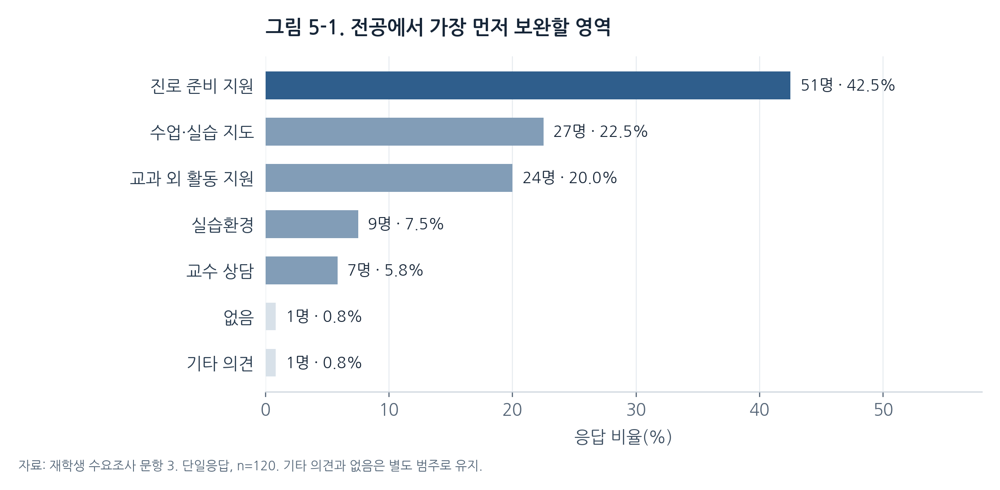
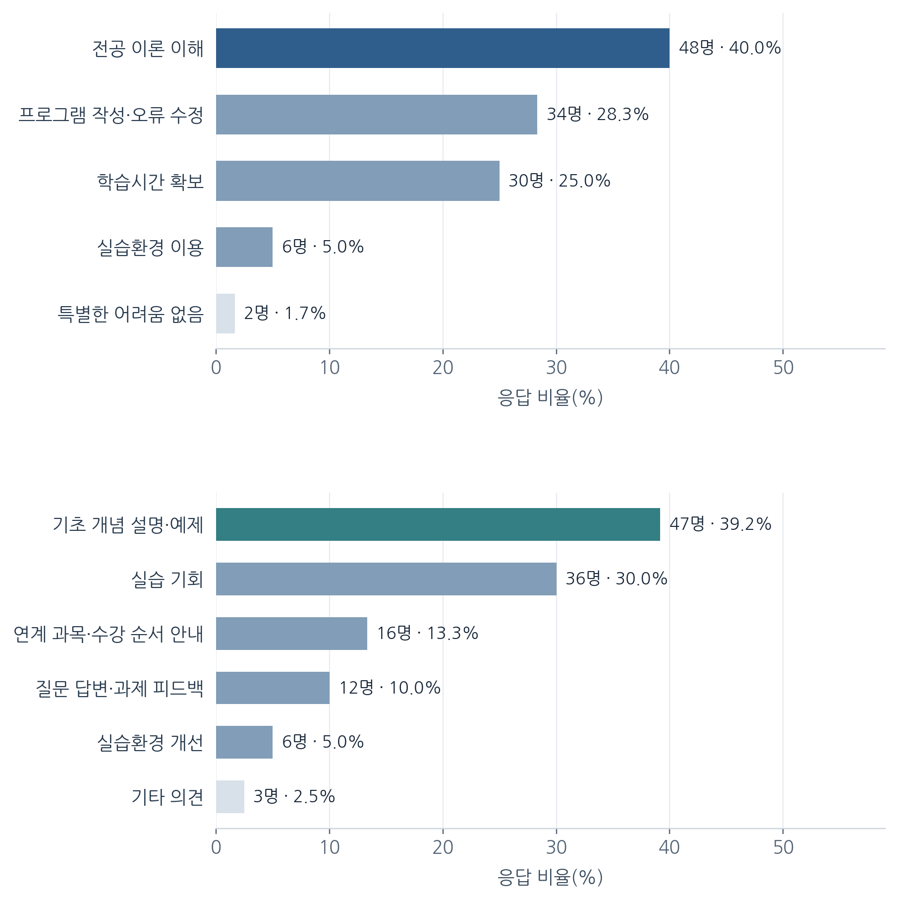
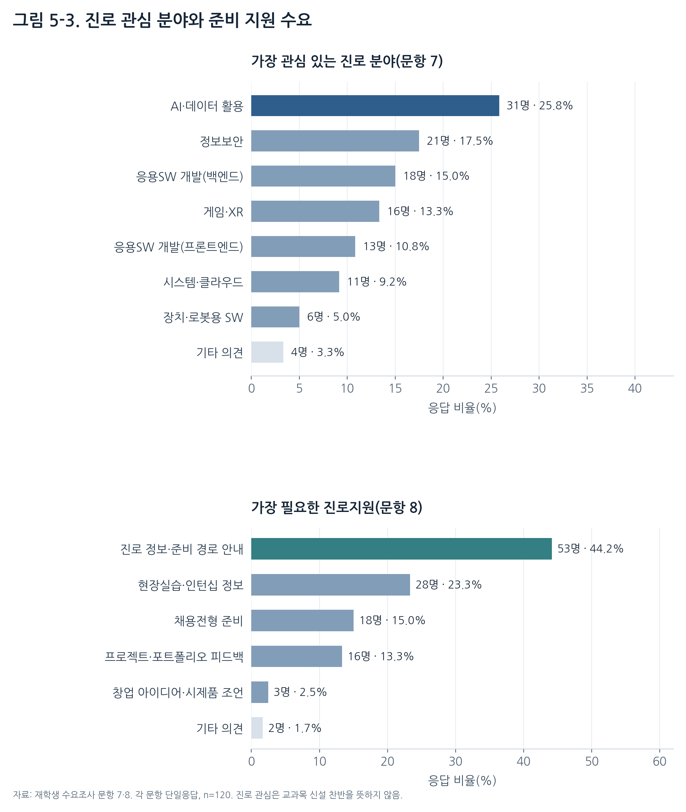
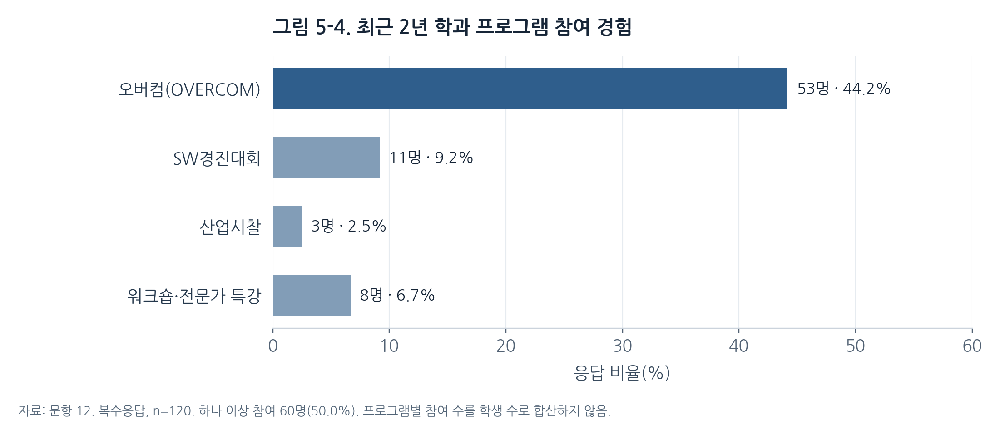
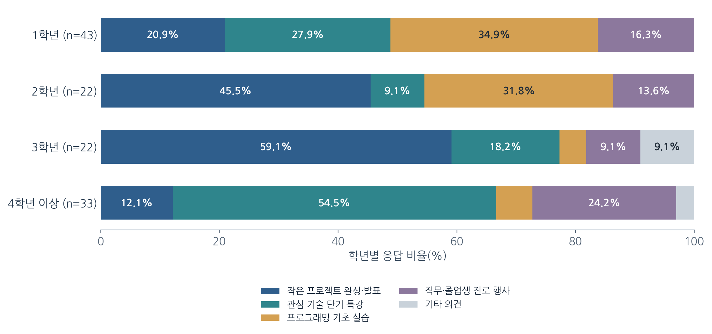
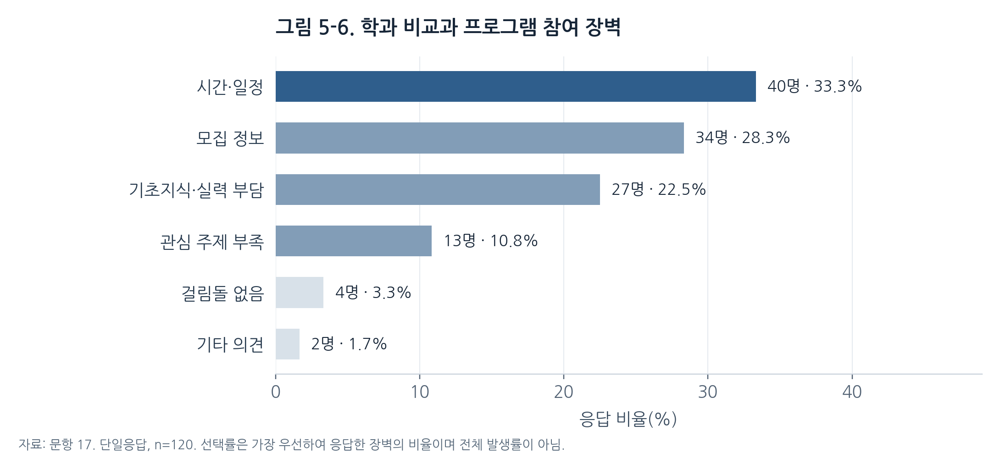

# 5. 재학생 수요조사

## 가. 개요

- 컴퓨터학전공 재학생을 대상으로 전공학습, 진로 준비, 교수 상담, 학과 비교과 프로그램 및 교육환경에 관한 수요조사를 실시함. 설문은 객관식과 자유의견을 포함한 19개 문항으로 구성하였으며, Google Forms를 활용하여 익명으로 진행함.
- 응답자료에 기록된 조사기간은 2026년 11월 16일부터 24일까지이며, 총 120건의 응답을 분석함. 이수 형태별로는 주전공 108명, 복수전공 11명, 부전공 1명이며, 학년별로는 1학년 43명, 2학년 22명, 3학년 22명, 4학년 이상 33명이 응답함.
- 주요 수요 문항은 단일응답으로, 프로그램 참여 경험은 복수응답으로 집계함. 조사 결과는 전공교육과 학생지원의 개선 방향을 수립하기 위한 기초자료로 활용함.

- 전공에서 가장 먼저 보완할 영역은 진로 준비 지원(42.5%)으로 가장 많았으며, 수업·실습 지도(22.5%), 교과 외 활동 지원(20.0%)이 뒤를 이음.

**그림 5-1. 전공 운영의 개선 우선순위**

## 나. 교과과정 및 학습지원 관련 수요조사 결과

### ○ 전공학습의 어려움과 필요한 지원

- 전공학습에서 가장 큰 어려움은 전공 이론 이해(40.0%), 프로그램 작성·오류 수정(28.3%), 학습시간 확보(25.0%) 순으로 나타남.
- 가장 필요한 학습지원은 기초 개념 설명·예제(39.2%)와 실습 기회(30.0%)였으며, 연계 과목·수강 순서 안내(13.3%), 질문 답변·과제 피드백(10.0%)에 대한 요구도 확인됨. 기초 설명과 예제, 실습 및 피드백이 단계적으로 연결되는 학습지원이 필요함.

**그림 5-2. 학습의 어려움과 필요한 지원**

위: 가장 큰 학습 어려움 / 아래: 가장 필요한 학습지원. 각 문항의 응답 비율을 표시함.

- 자유의견에서는 학습 내용을 충분히 이해할 수 있는 설명, 작은 단계로 구성된 과제, 스스로 구현하는 경험, 명확한 평가기준과 피드백 등이 제안됨. 학습 부담을 고려하면서 학생이 자신의 이해 수준을 확인하고 보완할 수 있는 수업 운영이 요구됨.

### ○ 교과목 구성과 이수 경로 안내

- 교과과정과 트랙에 관한 자유의견에서는 진로별 수강 순서, 교과목 간 연계성, 복수전공 학생의 과목 선택 기준을 구체적으로 안내해 달라는 요청이 제시됨. 학생이 자신의 관심 분야에 맞추어 이수 계획을 세울 수 있도록 교육과정 안내를 보완할 필요가 있음.
- 일부 학생은 정보보안·임베디드·AI 등 다양한 분야의 학습 기회와 일부 교과목의 개설 시기·학년 배치에 관한 의견을 제시함. 이러한 의견은 현재 교육과정과 개설 여건을 함께 확인하여 개선에 참고할 필요가 있음.

### ○ 실습환경에 대한 의견

- 전공에서 가장 먼저 보완할 영역으로 실습환경을 선택한 비율은 7.5%이며, 자유의견에서도 실습실·랩실의 환경 개선과 관리에 관한 요청이 제시됨.
- 실습실 이용 여건과 기자재 상태를 점검하고, 전공 수업과 프로젝트를 수행하는 데 필요한 학습환경을 보완할 필요가 있음.

## 다. 학과 운영 및 학생지원 관련 수요조사 결과

### ○ 취업·진로 지원에 대한 요구

- 졸업 직후 우선적으로 고려하는 진로는 컴퓨터·소프트웨어 관련 직무 취업(71.7%)이 가장 많았으며, 대학원 진학(10.8%)과 창업(3.3%)에 대한 수요도 확인됨. 관심 분야는 AI·데이터 활용(25.8%), 정보보안(17.5%), 백엔드 개발(15.0%), 게임·XR(13.3%) 등으로 다양하게 나타남.
- 진로 준비에 가장 필요한 지원은 진로 정보·준비 경로 안내(44.2%), 현장실습·인턴십 정보(23.3%), 채용전형 준비(15.0%), 프로젝트·포트폴리오 피드백(13.3%) 순임. 진출 분야별로 필요한 교과목, 프로젝트와 교과 외 활동, 취업 준비 과정을 연결하여 안내할 필요가 있음.

**그림 5-3. 진로 관심 분야와 준비 지원 수요**

위: 가장 관심 있는 진로 분야 / 아래: 가장 필요한 진로지원. 각 문항의 응답 비율을 표시함.

- 자유의견에서도 다양한 졸업생의 취업 준비 사례, 실제 직무에 도움이 된 교과목, 기업 연계 활동과 포트폴리오 등에 관한 정보 제공이 요청됨. 학생이 자신의 학습 경험을 진로 준비에 활용할 수 있도록 구체적인 사례 중심의 안내가 요구됨.

### ○ 교수 상담에 대한 요구

- 상담에서 도움받고 싶은 내용은 졸업 후 진로·준비 방향(56.7%), 전공 학습 방법(20.8%), 프로젝트·포트폴리오(15.0%) 순으로 나타남.
- 상담 이용의 가장 큰 장벽은 먼저 연락하거나 이야기를 꺼내는 부담(67.5%)이었으며, 원하는 도움을 받을 수 있을지에 대한 불확실성(17.5%), 신청 방법·대상을 모름(14.2%)이 뒤를 이음.
- 상담에서 다룰 수 있는 주제와 신청 방법을 명확히 안내하고, 학생이 학습과 진로에 관한 질문을 부담 없이 시작할 수 있는 여건을 마련할 필요가 있음.

### ○ 기존 비교과 프로그램의 참여 경험과 만족도

- 최근 2년 동안 학과 프로그램에 하나 이상 참여한 학생은 60명(50.0%)이며, 프로그램별로는 오버컴 참여가 가장 많았음.

**그림 5-4. 최근 2년 학과 프로그램 참여 경험**

전체 응답 120명을 기준으로 한 복수응답 결과임.

참여 여부와 만족도 응답을 대조하여 집계한 결과는 다음과 같음.

| 프로그램 | 참여 응답(명) | 유효 평가(명) | 평균 만족도(5점 만점) |
|---|---:|---:|---:|
| 오버컴 | 53 | 52 | 4.33 |
| SW경진대회 | 11 | 11 | 3.45 |
| 산업시찰 | 3 | 3 | 4.00 |
| 워크숍·전문가 특강 | 8 | 7 | 3.86 |

- 오버컴은 유효 평가 52명의 평균이 4.33점으로 긍정적인 평가를 받음. 프로그램 관련 자유의견에서는 다양한 진로 경험 공유, SW경진대회의 평가기준·피드백, 산업시찰과 워크숍의 홍보 및 참여 기회에 관한 요청이 제시됨.
- 산업시찰과 워크숍에 관한 의견은 해당 프로그램 참여를 선택하지 않은 학생들이 제시한 것으로, 프로그램 인지도와 참여 기회를 높이기 위한 요구로 참고할 필요가 있음.

### ○ 희망 비교과 활동과 참여 여건

- 앞으로 참여하고 싶은 활동은 작은 프로젝트 완성·발표와 관심 기술 단기 특강이 각각 30.0%로 가장 많았으며, 프로그래밍 기초 실습(20.8%), 직무·졸업생 진로 행사(16.7%)가 뒤를 이음.
- 학년별로는 1학년에서 기초 실습, 2·3학년에서 프로젝트 완성·발표, 4학년 이상에서 기술 단기 특강이 각각 가장 많이 선택됨. 학생의 학습 단계에 따라 기초 보완, 결과물 완성, 관심 기술 심화의 기회를 제공할 필요가 있음.

**그림 5-5. 학년별 희망 비교과 활동**

비율은 각 학년의 응답자 수를 기준으로 산출함.

- 선호하는 참여 방식은 대면(40.0%), 특별한 선호 없음(28.3%), 녹화 영상·자료 자율학습(20.0%), 실시간 온라인(11.7%) 순으로 나타남. 프로그램의 성격과 학생의 참여 여건을 고려하여 운영 방식을 선택할 필요가 있음.
- 참여의 가장 큰 장벽은 시간·일정(33.3%), 모집 정보(28.3%), 기초지식·실력 부담(22.5%)으로 나타남. 행사 일정과 모집 정보를 충분히 안내하고, 프로그램별 대상과 필요한 사전 지식을 명확히 제시할 필요가 있음. 일부 의견에서는 복수전공 학생의 참여 가능 여부를 알기 어렵다는 점도 제기되어 참여 자격에 대한 안내를 보완할 필요가 있음.

**그림 5-6. 학과 비교과 프로그램 참여 장벽**

## 라. 종합 시사점

- 전공교육에서는 기초 개념의 이해와 실제 구현 경험을 연결하고, 교과목 간 관계와 진로별 이수 경로를 안내하는 것이 주요 개선 과제임. 학생의 학습 단계와 부담을 고려하여 설명·예제·실습·피드백이 연계되도록 할 필요가 있음.
- 학생지원에서는 진로 준비 경로의 구체화와 교수 상담의 접근성 개선이 요구됨. 전공 관련 취업을 중심으로 다양한 진출 분야의 정보를 제공하고, 학생이 학습 및 진로 문제에 관해 도움을 요청하기 쉬운 환경을 조성할 필요가 있음.
- 비교과 프로그램은 기존 프로그램의 참여 경험과 학년별 선호를 바탕으로 개선하되, 일정·홍보·참여 자격·난이도 안내를 함께 보완할 필요가 있음. 이상의 결과를 교육과정 개선과 학생지원 계획 수립의 기초자료로 활용함.
